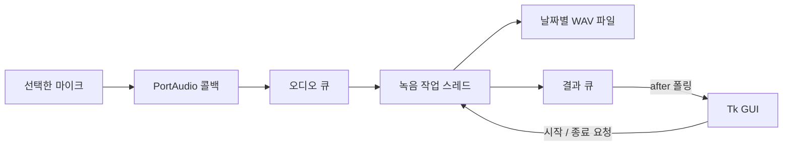

# Speaking Recorder

## 프로젝트 소개

Windows 10/11에서 영어 말하기 연습을 WAV로 녹음하는 한국어 데스크톱 앱입니다.
녹음 시작과 종료만 누르면 날짜별 폴더에 새 파일이 저장됩니다. 발음 평가는 앱에서 수행하지 않으며, 필요한 파일을 사용자가 직접 ChatGPT에 업로드하면 됩니다.

개인이 제작한 영어 말하기 연습용 녹음기입니다. 특정 시험 주관사와 제휴한 제품이 아니며, 공식 시험 문제·음원이나 채점 기능을 제공하지 않습니다.

**사용허락:** [MIT 라이선스](LICENSE)로 사용·수정·재배포·상업적 이용을 허용합니다. 저작권 표시와 라이선스 문구를 유지해야 하며, 소프트웨어는 보증 없이 제공됩니다. 외부 구성 요소에는 [별도 고지와 라이선스](THIRD_PARTY_NOTICES.md)가 적용됩니다.

앱 실행과 EXE 빌드는 **Windows Python**에서 수행합니다.

## 핵심 특징

- Tkinter + ttk 한국어 UI, 마이크 선택, 실시간 경과 시간과 빨간색 REC 표시
- `sounddevice.RawInputStream` → WAV Linear PCM 16-bit, Mono, 48,000Hz 우선
- 48kHz를 사용할 수 없으면 장치 기본 레이트 및 지원 가능한 다른 레이트를 확인하고 실제 레이트 표시
- 음량 보정, 노이즈 제거, 에코 및 리샘플링을 앱에서 적용하지 않음
- 실제 Windows 바탕화면의 `Speaking_Recordings/시작날짜/`에 자동 저장
- OneDrive 등 바탕화면 리디렉션 지원, 같은 초에 시작해도 기존 파일 보존
- 저장 위치 설정 유지, 탐색기 열기, 최근 저장 파일 비동기 재생
- 녹음 중 종료 시 저장 / 현재 녹음 삭제 / 취소 선택
- Windows 바탕화면 바로가기 및 독립 실행형 EXE 제공
- 실행 중 인터넷, 서버, 데이터베이스, 계정 불필요. 앱에는 업로드 기능이 없음

## 아키텍처

| 구성 요소 | 역할 |
|---|---|
| `speaking_recorder/app.py` | Windows 초기화, Tk와 오디오 백엔드 조립 |
| `speaking_recorder/ui/` | 화면 배치(`view.py`)와 사용자 입력·상태 제어(`app.py`) |
| `speaking_recorder/recording.py` | 녹음 작업 스레드, 오디오 큐, 시작·종료 이벤트 |
| `speaking_recorder/wav.py` | 파일명 충돌 방지, PCM 기록, WAV 헤더와 파일 마무리 |
| `speaking_recorder/devices.py` | 마이크 목록과 기본 장치 선택 |
| `speaking_recorder/settings.py` | 저장 위치 설정 읽기·원자적 저장 |
| `speaking_recorder/windows.py` | Windows 폴더, 마이크 권한, 재생, 탐색기, DPI |
| `main.py` | 실행 진입점과 기존 import 호환 |
| `Speaking_Recorder.spec`, `build.bat`, `scripts/` | EXE 빌드, 아이콘 생성, 배포 패키지 검증 |
| `tests/` | WAV·파일 I/O, Windows Tk 동작, 모듈 의존 경계 테스트 |

핵심 원칙은 **UI가 녹음 엔진에 의존하고, 녹음 엔진은 UI를 모르게 하는 것**입니다.
디렉터리 구조, 의존 방향, 스레드·파일 소유권 및 다른 앱에서의 사용 방법은
[아키텍처 문서](docs/architecture.md)에 정리했습니다.



## 바로 사용하기

빌드와 설치가 완료된 컴퓨터에서는 Windows 바탕화면의 **Speaking Recorder** 바로가기를 더블클릭합니다.
바로가기는 `%LOCALAPPDATA%\Programs\SpeakingRecorder\Speaking_Recorder.exe`를 실행하므로 WSL이 꺼져 있어도 실행됩니다.

바탕화면의 블랙 글라스·네온 마이크·빨간 녹음 표시 아이콘으로 앱을 찾을 수 있습니다.
창 테두리나 오른쪽 아래 모서리를 드래그하면 가로·세로 크기를 조절할 수 있으며,
제목 표시줄의 최대화 버튼도 사용할 수 있습니다. 창을 늘리면 녹음 버튼과 내용 영역도 함께 늘어납니다.

1. **USB 마이크 (기본)** 또는 **JBL Tour Pro 3 마이크**처럼 표시되는 실제 마이크를 선택합니다. 같은 장치의 드라이버 중복 항목은 숨기며 기본 마이크를 자동 선택합니다.
2. **녹음 시작**을 누릅니다. 마이크가 열리면 `● REC`, 경과 시간 및 `녹음 중`이 표시됩니다.
3. 영어로 말한 뒤 **녹음 종료 및 저장**을 누릅니다.
4. `저장 완료`가 표시되면 **최근 파일 재생**으로 확인합니다.
5. **저장 폴더 열기**로 파일을 확인합니다. 최근 파일이 있으면 해당 날짜 폴더를 엽니다.

장치 드라이버 초기화에 짧은 시간이 필요할 수 있습니다. `REC` 표시를 확인한 뒤 말해주세요.
재생 중 다시 녹음을 시작하면 이전 재생을 중지합니다. 다른 파일을 듣고 싶으면 탐색기에서 WAV를 엽니다.

### 키보드 사용

앱 창이 활성화된 상태에서 사용합니다. 버튼 옆 단축키와 **단축키 안내 (F1)**로 확인할 수 있습니다.

| 단축키 | 동작 |
|---|---|
| Ctrl+R | 녹음 시작 |
| Ctrl+S | 녹음 종료 및 저장 |
| Ctrl+P | 최근 파일 재생 |
| Esc | 재생 중지 — 진행 중인 녹음은 유지 |
| Ctrl+O | 저장 폴더 열기 |
| F5 | 마이크 새로 고침 |
| F1 | 단축키 안내 |
| Tab / Shift+Tab | 다음 / 이전 항목으로 이동 |
| Space | 선택한 버튼 실행 |

비활성 버튼은 단축키로도 실행되지 않으며, 팝업이 열린 동안에는 뒤쪽 앱을 조작하지 않습니다.
한글 입력 상태에서도 Ctrl 단축키를 사용할 수 있습니다.

## 소스로 실행하기

Windows 10/11과 Python 3.11 이상이 필요합니다. Python 설치 시 Python Launcher와 Tcl/Tk 항목을 포함하세요.
이 프로젝트에서 확인한 빌드 환경은 Windows Python 3.12 x64입니다.

Windows 명령 프롬프트에서 다음을 실행합니다. 아래 경로는 실제 프로젝트 위치로 바꾸세요.

```bat
cd /d C:\dev\speaking-recorder
py -3 -m venv .venv-win
.venv-win\Scripts\python.exe -m pip install -r requirements.txt
.venv-win\Scripts\python.exe main.py
```

의존성 최초 설치에는 인터넷이 필요합니다. 설치 후 앱은 오프라인으로 동작합니다.
`wave`, `tkinter`, `winsound`, `ctypes`는 Python 표준 라이브러리를 사용합니다. NumPy와 soundfile은 필요하지 않습니다.

## EXE 빌드 및 바탕화면 바로가기

Windows 탐색기에서 프로젝트의 **`build.bat`를 더블클릭**하거나 Windows 명령 프롬프트에서 실행합니다.

```bat
cd /d C:\dev\speaking-recorder
build.bat
```

자동 처리 순서:

1. Windows Python 3.11 이상을 확인하고 `.venv-win` 가상환경을 만듭니다.
2. `requirements.txt`의 패키지를 설치하고 자동 테스트를 실행합니다.
3. Python 런타임, Tcl/Tk, PortAudio DLL, CFFI를 포함한 단일 EXE를 만듭니다.
4. **`dist\Speaking_Recorder.exe`**를 Windows 로컬 앱 폴더에 복사합니다.
5. 실제 Windows 바탕화면에 **`Speaking Recorder.lnk`**를 만듭니다.

Windows 빌드는 Windows Python으로 수행해야 합니다. WSL의 Linux Python으로 Windows EXE를 만들 수는 없습니다.
WSL 터미널에서 Windows 빌드를 호출하려면 다음을 사용합니다.

```bash
cmd.exe /d /c "$(wslpath -w ./build.bat) --no-pause"
```

공개 배포에는 `dist\Speaking_Recorder-windows.zip`을 사용하세요. EXE와 MIT 라이선스, 외부 라이브러리 고지 원문이 함께 들어 있습니다. 빌드 시 EXE 내부의 고지 내용과 ASIO DLL 제외 여부를 검증한 뒤 ZIP을 만듭니다.

실행에는 `dist\Speaking_Recorder.exe`만 있으면 됩니다. 라이선스 원문은 EXE 내부에도 포함됩니다.
그 컴퓨터에는 Python이나 pip 패키지가 필요하지 않습니다. 바로가기 자동 설치도 원하면
`install-shortcut.ps1`를 함께 복사하고 Windows PowerShell에서 아래처럼 실행하세요.

```powershell
powershell.exe -NoProfile -ExecutionPolicy Bypass -File .\install-shortcut.ps1 -ExecutablePath .\Speaking_Recorder.exe
```

`ExecutionPolicy Bypass`는 해당 PowerShell 프로세스에만 적용되며 시스템 실행 정책을 변경하지 않습니다.
업데이트할 때 실행 중인 앱을 먼저 닫고 `build.bat`를 다시 실행하세요.
다른 CPU 아키텍처가 필요하면 해당 Windows/Python 환경에서 다시 빌드해야 합니다.

### 녹음 보관 폴더 아이콘

`Speaking_Recordings` 폴더에는 검은 유리 타일과 청록·보라 음성 파형 아이콘을 적용할 수 있습니다.
폴더가 만들어진 뒤 아래 명령을 실행합니다. 다른 저장 위치에는 `-FolderPath 'D:\녹음'`을 추가하세요.

```powershell
powershell.exe -NoProfile -ExecutionPolicy Bypass -File .\install-recordings-icon.ps1
```

아이콘과 `desktop.ini`는 해당 폴더 안에 숨김 파일로 보관됩니다. 기존 녹음 파일은 변경하지 않습니다.
원본 이미지는 `assets/speaking-recordings.png`, Windows 아이콘은 `assets/speaking-recordings.ico`입니다.

## 파일 및 설정 관리

```text
실제 Windows 바탕화면/
└── Speaking_Recordings/
    └── 2026-11-15/
        ├── 09h00m_Speaking_20261115_090000.wav
        ├── 09h00m_Speaking_20261115_090000_0001.wav
        └── 09h15m_Speaking_20261115_091530.wav
```

파일명은 `19h23m_`처럼 24시간제 시·분으로 시작합니다. Windows 로컬 시각의 **녹음 시작 날짜·시간**을 사용합니다. 자정을 넘겨 종료해도 시작 날짜 폴더에 저장됩니다.
파일 생성은 배타적 생성 모드로 수행하므로 다른 앱 인스턴스와 이름이 겹쳐도 덮어쓰지 않습니다.
48kHz PCM16 Mono의 크기는 약 5.76MB/분입니다.

**위치 변경**에서 선택한 저장 위치는 `%LOCALAPPDATA%\SpeakingRecorder\settings.json`에 저장됩니다.
이전 버전의 저장 위치 설정이 있으면 그대로 사용하며, 기존 녹음 파일은 이동하거나 이름을 바꾸지 않습니다.
프로그램·설정·녹음 파일은 서로 별개입니다. 앱 제거 시 EXE 설치 폴더와 바로가기를 삭제하면 되며 녹음은 남습니다.

바탕화면이 OneDrive 폴더라면 앱이 저장한 파일을 **OneDrive 자체가 동기화할 수 있습니다**.
앱은 네트워크 전송을 하지 않습니다. 로컬에만 보관하려면 **위치 변경**에서 동기화되지 않는 폴더를 선택하세요.

## 녹음 품질 및 오류 처리

- 실제 입력 장치가 수락한 레이트로 저장하며, 48kHz 미지원 시 화면에 `호환 레이트 사용`을 표시합니다.
- 앱은 음성 효과를 적용하지 않습니다. Windows나 마이크 드라이버의 음성 향상·AGC는 별도 설정이므로 원음이 필요하면 해당 설정을 끄세요.
- 녹음 중 시작·마이크 변경·저장 위치 변경을 막아 중복 작업을 방지합니다.
- 입력 오버플로, 큐 포화, 비활성 스트림, 3초 이상 콜백 중단을 감지하면 종료하고 수신한 데이터를 가능한 범위에서 저장합니다. 누락 가능성을 오류창으로 안내합니다.
- 종료 시 스트림을 먼저 정지·닫고 남은 큐를 처리한 뒤 WAV 헤더를 확정합니다. 성공한 샘플은 재처리하지 않습니다.
- 쓰기 오류가 발생하면 완료된 블록까지만 남기도록 시도합니다. 디스크 자체 고장, 권한 변경, 강제 종료·전원 차단에서는 전체 복구를 보장할 수 없습니다.
- 녹음 중 약 1초마다 헤더·파일 버퍼를 갱신하며, 정상 종료 때 `fsync`를 수행합니다. 강제 종료 복구 기능은 별도로 제공하지 않습니다.
- 일반 RIFF WAV의 약 4GB 한계에 도달하면 종료합니다. 장시간 무제한 녹음용 프로그램은 아닙니다.
- Windows 장치 목록은 드라이버에 따라 새 장치가 즉시 반영되지 않을 수 있습니다. 새로 고침 후에도 없으면 앱을 재실행하세요.
- 입력이 없으면 Windows 설정의 마이크 접근 및 **데스크톱 앱의 마이크 접근 허용**, 마이크 연결, 다른 앱의 독점 사용을 확인하세요.

## 테스트

WSL에서 하드웨어 없는 핵심 테스트:

```bash
cd /path/to/speaking-recorder
python3 -m unittest discover -s tests -v
python3 -m compileall -q main.py speaking_recorder tests
```

Windows에서 GUI 테스트까지 실행:

```bat
.venv-win\Scripts\python.exe -m unittest discover -s tests -v
```

핵심 테스트는 임시 폴더에 **실제 WAV를 저장하고 다시 읽습니다**. 마이크 경계만 가짜 장치로 대체합니다.
30초 분량 PCM의 샘플 일치, 마지막 콜백 저장, 반복 녹음, 파일명 충돌, 레이트 대체,
장치 분리, 버퍼 포화, 입력 오류, 파일 쓰기 실패와 설정 복원을 확인합니다.
Windows GUI 테스트는 실제 Tk 위젯에서 시작·종료 버튼, 저장 후 재생 활성화,
종료 취소·저장·삭제를 확인하지만 사람의 발음과 실제 마이크 음질을 검증하지는 않습니다.

GUI 테스트는 Windows에서 실행하며, 실제 마이크 음질은 아래 수동 확인 항목으로 검증합니다.

### 최종 사용자 확인

1. 바탕화면 바로가기로 앱을 실행합니다.
2. 실제 사용할 마이크를 선택하고 30초간 영어로 말합니다.
3. 종료 후 오늘 날짜 폴더의 WAV를 재생하고 소리, 끊김, 음량을 확인합니다.
4. 다시 녹음하여 첫 파일이 그대로 남아 있는지 확인합니다.
5. 저장 위치를 바꾸고 재실행해 위치가 유지되는지 확인합니다.
6. 사용하는 Windows 배율과 모니터에서 버튼·경로 표시를 확인합니다.

마이크 접근이 차단된 경우 긴 드라이버 오류 대신 켜야 할 Windows 설정을 안내합니다. 설정을 켠 뒤 앱에서 다시 녹음 시작을 누르면 됩니다.
