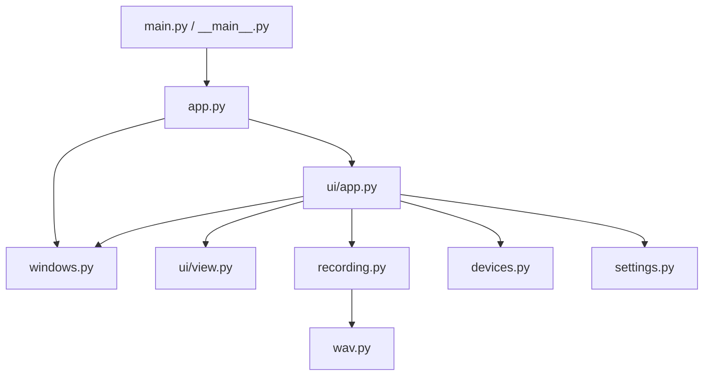

# 아키텍처와 변경 원칙

이 앱은 **로컬 녹음 엔진에 Windows 데스크톱 UI를 붙인 구조**다.
분리 기준은 줄 수보다 변경 이유다. 녹음 안정성, 파일 형식, 장치 표시 정책,
운영체제 연동, 화면 배치를 각각 독립적으로 바꿀 수 있게 한다.

## 디렉터리 구조

```text
main.py                     실행 진입점과 기존 import 호환
speaking_recorder/
├── __init__.py             GUI 없는 공개 API: Recorder, RecordingResult
├── __main__.py             python -m speaking_recorder 실행
├── app.py                  Windows 확인, DPI 설정, Tk와 sounddevice 조립
├── metadata.py             앱 이름
├── autotune.py             노래 모드 하드튠: native/ta_autotune.dll(C ABI) 래퍼, 테이크 튜닝·원본 .raw 보존
├── native/                 ta_autotune.dll (~/__dev/trap-autotune에서 빌드한 하드 튠 DSP)
├── monitoring.py           노래 모드 라이브 모니터링(녹음과 독립된 WASAPI 저지연 duplex 스트림)
├── modes.py                영어·노래 모드별 저장 폴더와 설정 파일 이름
├── recording.py            녹음 수명 주기, 작업 스레드, 이벤트
├── wav.py                  파일명 충돌 방지, PCM 기록, WAV 마무리
├── devices.py              마이크 목록 정리와 기본 장치 선택
├── settings.py             설정 읽기와 원자적 저장
├── windows.py              Known Folder, 마이크 권한, 재생, 탐색기, DPI
└── ui/
    ├── launcher.py         첫 화면 모드 선택(캔버스 애니메이션)
    ├── app.py              사용자 입력, 화면 상태, 이벤트 소비
    ├── view.py             영어 모드 위젯 소유와 화면 배치
    └── song_view.py        노래 모드 스테이지(레코드 원 버튼, 모니터링, Takes 목록). 같은 컨트롤러를 쓰며 없는 컨트롤은 None
tests/                      실제 WAV·파일 I/O, Windows GUI, 의존 경계 검사
scripts/                    아이콘 생성과 배포 ZIP 검증·생성
assets/                     앱·폴더 아이콘 원본
licenses/                   외부 구성 요소 라이선스 원문
docs/                       유지보수 문서
Speaking_Recorder.spec          버전 관리하는 EXE 빌드 명세
build.bat                   사용자가 실행하는 Windows 빌드 진입점
install-*.ps1               사용자가 실행하는 설치 진입점
build/, dist/               생성물, Git 제외
```

프로젝트 루트에서 바로 실행하고 빌드하는 현재 흐름을 유지하므로 패키지도 루트에 둔다.
패키지 배포가 필요해지면 그때 설치 메타데이터와 `src/` 전환을 함께 검토한다.

## 의존 방향



- `recording.py`, `wav.py`, `devices.py`, `settings.py`는 UI와 Windows 모듈을 import하지 않는다.
- `sounddevice`는 시작 지점에서 생성해 `Recorder`에 전달한다. 테스트에서는 같은 호출 형태의 가짜 오디오 장치를 전달한다.
- `view.py`는 위젯을 소유하며 전달받은 콜백만 호출한다. 녹음, 설정 저장, 스레드 생성은 하지 않는다.
- `ui/app.py`는 화면 상태와 사용자 의도를 연결한다. WAV 헤더나 PortAudio 콜백을 다루지 않는다.
- 첫 화면 `ModeLauncher`가 모드를 고르면 같은 `RecorderApp`이 그 모드의 폴더와 설정 파일로 열린다. 영어는 `Speaking_Recordings`·`settings.json`, 노래는 `Song_Recordings`·`song-settings.json`을 쓴다.
- 노래 모드 듣기는 우선 DLL의 C++ WASAPI 엔진(`autotune.NativeMonitor`)을 쓴다: 마이크 독점(가능할 때), 헤드폰 공유, 하드튠은 오디오 스레드 안에서 처리. 마이크를 독점하는 동안 녹음기는 `NativeCaptureAudio`(sounddevice와 같은 모양의 어댑터)로 엔진의 마이크 샘플을 받는다. 녹음 중 듣기를 끄면 엔진은 멈추지 않고 음소거만 하며, 녹음이 끝난 뒤 멈춘다. 엔진을 시작할 수 없으면 PortAudio 경로로 자동 전환한다.
- 라이브 모니터링은 녹음 엔진과 별도 스트림이다. 모니터링 실패·중단은 녹음과 WAV 파일에 영향을 주지 않는다. 마이크를 독점하는 WASAPI exclusive 모드는 녹음 스트림을 막으므로 쓰지 않는다.
- 하드튠은 녹음 엔진을 거치지 않는다. 녹음은 항상 원본을 저장하고, 저장이 끝난 뒤 별도 스레드가 튠한 파일을 임시 파일로 만들어 검증한 다음 원본을 `.raw/`로 옮기고 교체한다. 실패하면 원본이 그대로 남는다. 실시간 듣기와 파일은 같은 DSP(블록 크기와 무관하게 동일 출력)라 들은 소리와 저장된 소리가 같다.
- 공용 `utils.py`나 거대한 `constants.py`를 만들지 않는다. 기능과 상수는 책임을 가진 모듈에 둔다.
- 새 추상 클래스나 계층은 실제 대체 구현이 필요해질 때 추가한다.

## 스레드와 파일 소유권

1. 오디오 콜백은 PCM 바이트를 크기 제한 큐에 넣는다. 파일과 Tk 위젯에는 접근하지 않는다.
2. 녹음 작업 스레드 하나가 오디오 스트림과 WAV 파일을 연 뒤 끝까지 소유한다.
3. 종료 시 스트림을 먼저 정지하고 남은 큐를 저장한 다음 WAV 헤더를 확정한다.
4. UI 스레드는 `root.after`로 이벤트를 소비하고 위젯을 갱신한다. 마이크 조회도 별도 작업 스레드에서 수행한다.
5. 저장 오류가 나면 성공한 블록까지만 보존한다. 새 녹음은 기존 파일을 덮어쓰지 않는다.
6. 녹음 중 종료·삭제 결정은 UI 정책이다. 녹음 엔진은 먼저 파일을 마무리하고 결과를 반환한다.

## 다른 앱에서 사용하는 경계

```python
from pathlib import Path

import sounddevice
from speaking_recorder import Recorder

recorder = Recorder(sounddevice)
recorder.start(Path("recordings"), device=0)  # 실제 입력 장치 인덱스 사용
# 호출 앱이 자신의 이벤트 루프에서 recorder.events를 소비한다.
# 종료 요청: recorder.stop()
```

- `start(folder, device)`는 비동기다. 반환 직후 마이크가 열렸다고 가정하지 않는다.
- `events`의 `("started", {"rate": int, "started": float})`는 스트림 시작을 알린다. 시각은 `time.monotonic()` 기준이다.
- `stop()`은 종료 요청만 한다. UI 스레드에서 완료될 때까지 기다리지 않는다.
- `("finished", RecordingResult)`를 받은 뒤 파일을 읽는다. `path`가 없을 수 있고 `error`와 `playable`을 함께 확인해야 한다.
- `finished`는 작업 스레드의 마지막 이벤트다. 다시 시작하기 전 `thread.is_alive()`가 거짓인지 확인한다. GUI가 없는 호출자는 `thread.join()`을 쓸 수 있다.
- 큐는 소비자 하나를 전제로 한다. 여러 소비자가 동시에 읽으면 이벤트가 분산된다.
- 공개 API는 `speaking_recorder.Recorder`와 `RecordingResult`다. 기존 `main.Recorder` import도 유지한다. UI 내부 위젯은 `RecorderApp.view`에 있다.

이는 같은 Python 프로세스에서 사용할 수 있는 경계다. **다른 프로세스가 EXE를 제어하는 IPC/API는 아직 구현하지 않았다.** 필요해지면 별도 어댑터를 추가하고 같은 녹음 엔진을 사용한다.

## 변경과 검증 기준

- 녹음·저장 변경: 실제 WAV를 다시 읽는 테스트로 샘플, 종료 직전 데이터, 오류 시 보존을 확인한다.
- UI 변경: Windows Tk 테스트로 단축키, 상태 전환, 종료 선택, 창 크기를 확인한다.
- 모듈 변경: GUI·Windows·오디오 드라이버 없이 핵심 패키지를 import하는 경계 테스트를 유지한다.
- 배포 변경: Windows EXE를 빌드하고 `scripts/package_release.py`로 라이선스 원문과 ASIO 제외 여부를 확인한다.
- 소스 실행과 EXE 실행에서 모두 아이콘을 찾을 수 있어야 한다. 소스 기준 경로와 PyInstaller 추출 경로를 구분한다.
- 네트워크 전송 기능은 없다. 녹음 파일과 설정은 사용자 PC에 저장한다.
